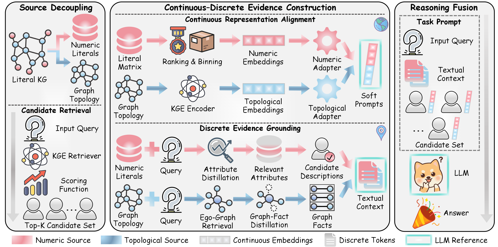

# NumLP
Breaking the Representation Barrier: LLM-Empowered Link Prediction on Knowledge Graphs with Numeric Literals


## Environment
**Step1** Create a virtual environment using ```Anaconda``` and enter it.
```bash
conda create -n NumLP python=3.10
conda activate NumLP
```
**Step2**  Install package.
+ Install from source
```bash
cd NumLP-main
pip install -r requirements.txt
```

## Training
**FB15K237**
```bash
bash script/train_fb.sh {TransE|DistMult|ComplEx|ConvE|RotatE|TuckER}
```
**YAGO15K**
```bash
bash script/train_yg.sh {TransE|DistMult|ComplEx|ConvE|RotatE|TuckER}
```
**LitWD19K**
```bash
bash script/train_wd.sh {TransE|DistMult|ComplEx|ConvE|RotatE|TuckER}
```


## Inference
```bash
bash script/eval.sh {FB15K237|YAGO15K|LitWD19K} {TransE|DistMult|ComplEx|ConvE|RotatE|TuckER}
```